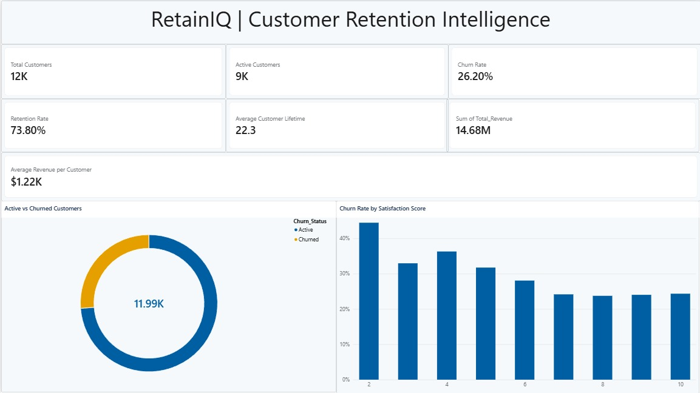
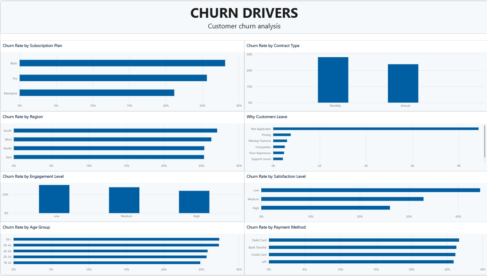
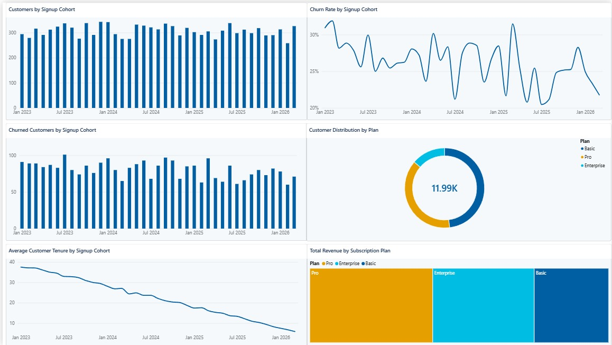

# RetainIQ — Customer Retention & Churn Analysis

## Project Overview
RetainIQ is a customer analytics project built using Microsoft Power BI to investigate customer churn, retention patterns, customer lifetime, and revenue. The report translates customer data into actionable recommendations for improving retention.

## Business Problem
Customer churn can reduce recurring revenue and long-term customer value. This project explores which customer groups have higher churn rates and identifies areas where retention strategies may help.

## Project Objectives
- Measure customer churn and retention.
- Compare churn across subscription plans, contract types, regions, and customer segments.
- Explore the relationship between engagement, satisfaction, and churn.
- Analyze customer lifetime and revenue patterns.
- Compare customer signup cohorts.
- Recommend practical retention improvements.

## Tools & Technologies
- Microsoft Power BI
- DAX measures and calculated columns
- Data analysis and visualization
- Python for exploratory data analysis, where applicable

## Dashboard Pages
1. **Executive Overview** — Core customer, churn, retention, and revenue KPIs.
2. **Churn Drivers** — Churn comparisons by plan, contract, region, engagement, satisfaction, age group, and payment method.
3. **Retention & Revenue** — Customer lifetime, revenue comparisons, and monthly churn trends.
4. **Cohort & Retention Analysis** — Signup cohort comparisons, customer distribution, tenure, and revenue.
5. **Business Insights & Recommendations** — Findings and proposed retention actions.

## Dashboard Preview

### Executive Overview

### Churn Drivers

### Cohort & Retention Analysis

## Key Findings
- Overall churn rate: approximately **26.20%**.
- Overall retention rate: approximately **73.80%**.
- Monthly contracts show a higher churn rate than annual contracts in this dataset.
- The Basic subscription plan has a higher churn rate than Pro and Enterprise plans.
- Lower engagement and satisfaction are associated with higher churn.
- Churned customers have lower average revenue and shorter average tenure than active customers.

*Note: Figures should be checked against the final Power BI report before publication. These are dataset-specific observations, not proof of causation.*

## Recommendations
- Test incentives that encourage suitable customers to move to annual contracts.
- Identify low-engagement customers and run targeted re-engagement campaigns.
- Investigate pricing concerns and missing-feature feedback.
- Improve onboarding and monitor churn during the early customer lifecycle.
- Track churn, retention, and revenue metrics regularly to evaluate interventions.

## Repository Contents
- `dashboard/` — Power BI report file (`.pbix`).
- `screenshots/` — Dashboard page screenshots.
- `data/` — Include the dataset only if redistribution is permitted.

## Limitations
The findings reflect the available dataset and the definitions used in the analysis. Relationships between customer attributes and churn are observational and should not automatically be interpreted as causal.

## Author
**Chitra Saravanan**

Portfolio: https://portfolioo-kappa-gules.vercel.app/
